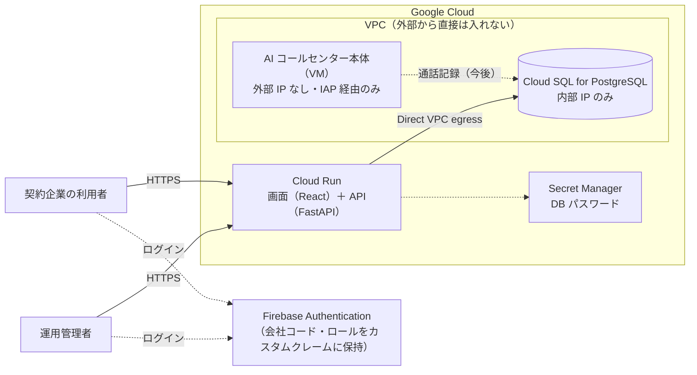

# AI Call Center Portal

[ai-callcenter-ollama](https://github.com/mismd2026/ai-callcenter-ollama)（自社完結型の AI コールセンター）を契約した企業向けの**顧客ポータル**と、事業者側の**運用コンソール**です。

AI コールセンターの本体はインターネットに公開せず、**このポータルだけを、ログイン必須で公開する**構成にしています。

**デモ（ログイン不要・架空データ）**：https://mismd2026.github.io/ai-callcenter-portal/

> English: Customer portal and operator console for a self-hosted AI call center. React + TypeScript frontend, FastAPI backend, Firebase Authentication with custom claims for tenant isolation, Cloud Run + private-IP Cloud SQL provisioned with Terraform. The AI core stays off the internet.

## 画面

| 画面 | 利用者 | 内容 |
| --- | --- | --- |
| 顧客ポータル | 契約企業の契約管理者・閲覧者 | 導入プロセス、月別コール数、問い合わせ種別、対応履歴、オペレーター対応・障害のお知らせ、費用・請求、解約の申し込み |
| 運用コンソール | 事業者の運用管理者 | テナントごとの契約一覧、同時コール数の逼迫状況、本日のエスカレーション・未回答質問、利用者とロール |

## 構成



## セキュリティ設計

元のプロトタイプ（ローカル検証用）から、公開に向けて次の点を作り直しました。

| 元の作り | 問題 | この版での対策 |
| --- | --- | --- |
| URL に会社コードを含める（`/api/companies/ACME-TOKYO`） | URL を書き換えると他社のデータが見える | 会社コードとロールは **Firebase の ID トークンのカスタムクレーム**から取得し、URL やリクエストからは受け取らない |
| ログインなし | 誰でも閲覧できる | Firebase Authentication。トークンの失効も確認（`check_revoked`） |
| CORS を全許可 | 他サイトから API を呼べる | 画面と API を同じオリジンから配信し、CORS は許可しない |
| 顧客にサーバー・ネットワークログを表示 | 内部情報の露出 | 顧客にはオペレーター対応と障害のお知らせだけを表示 |
| Flask のデバッグモード・SQLite | 本番に不向き | FastAPI＋PostgreSQL（内部 IP のみ）。入力は型と正規表現で検証 |

そのほか、セキュリティヘッダー（CSP・HSTS・X-Frame-Options）、API 応答のキャッシュ禁止、解約申し込みは契約管理者のみ、などを実装しています。認可はすべてテストで確認しています（`api/tests/test_authz.py`）。

### ロール

| ロール | 付け方（`scripts/set_claims.py`） | できること |
| --- | --- | --- |
| `company_admin` | `... tanaka@acme.example company_admin ACME-TOKYO` | 自社の閲覧、解約の申し込み |
| `viewer` | `... suzuki@acme.example viewer ACME-TOKYO` | 自社の閲覧のみ |
| `ops_admin` | `... ops@example.com ops_admin` | 運用コンソール（全テナント） |

## 技術スタック

| 項目 | 内容 |
| --- | --- |
| 画面 | React 18 / TypeScript / Vite / Tailwind CSS / Recharts |
| API | Python / FastAPI / SQLAlchemy |
| 認証 | Firebase Authentication（メール＋パスワード、カスタムクレーム） |
| DB | PostgreSQL 16（Cloud SQL、内部 IP のみ）／ローカルは SQLite |
| インフラ | Cloud Run / Cloud SQL / Secret Manager / Artifact Registry（Terraform） |
| CI | GitHub Actions：API のテストを SQLite と PostgreSQL の両方で実行、型チェック、コンテナの起動確認、Terraform の検証、デモ版の自動公開 |

## ローカルでの実行

```bash
# API（開発用の認証モード。Cloud Run では起動を拒否する）
cd api
pip install -e ".[dev]"
AUTH_MODE=insecure-dev SEED_DEMO_DATA=true uvicorn app.main:create_app --factory --port 8080

# 画面（別のターミナル）
cd web
npm install
npm run dev        # API に接続する版
npm run dev:demo   # API なしで動くデモ版
```

テスト：

```bash
cd api && pytest -q
cd web && npm test
```

## Google Cloud へのデプロイ

前提：[ai-callcenter-ollama の Terraform](https://github.com/mismd2026/ai-callcenter-ollama/tree/main/deploy/terraform/gcp) で VPC（`callcenter-vpc`）を作成済みであること。

1. **Firebase の準備**（[Firebase コンソール](https://console.firebase.google.com/)）
   - 「プロジェクトを追加」から、既存の GCP プロジェクトを選んで Firebase を有効にする
   - Authentication で「メール / パスワード」を有効にし、利用者を追加する
   - 「プロジェクトの設定」の Web API キーを控える
2. **イメージの置き場を作る**
   ```bash
   cd deploy/terraform
   cp terraform.tfvars.example terraform.tfvars   # 値を編集
   terraform init
   terraform apply -target=google_artifact_registry_repository.portal
   ```
3. **コンテナをビルドする**（リポジトリ直下で）
   ```bash
   gcloud builds submit --tag asia-northeast1-docker.pkg.dev/<PROJECT_ID>/portal/portal:v1 .
   ```
4. **残りを作成する**
   ```bash
   terraform apply
   terraform output url
   ```
5. **利用者にロールを付ける**
   ```bash
   pip install firebase-admin
   python scripts/set_claims.py tanaka@acme.example company_admin ACME-TOKYO --project <PROJECT_ID>
   ```

試し終わったら `terraform destroy` で削除してください。Cloud SQL は時間課金です。

## データについて

画面に表示されるデータはすべて架空のものです（`scripts/generate_fixture.py` で生成）。
API の初期データとデモ版は、同じ `fixtures/demo.json` を使っています。

## 経緯

ローカル検証用に作った phase2-core（AI コールセンターのプロトタイプ）のダッシュボードを、インターネットに公開できる形に作り直したものです。DB スキーマは phase2-core の設計（テナント > 契約 > 利用者、ライセンス、導入プロセス、請求、対応履歴）を移植しています。

## License

MIT
